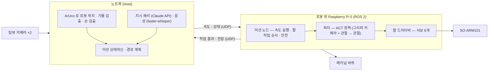

<div align="center">

# 🤖 Grippers

**장판 위 물건을 스스로 찾아 바구니에 정리하고, 부탁하면 사람 손에 가져다주는 모바일 매니퓰레이터**

탑뷰 카메라 2대 · 메카넘 차체 · SO-ARM101 팔 · 학습된 파지 정책(ACT)

</div>

---

## Table of Contents

- [무엇을 하나](#무엇을-하나)
- [어떻게 동작하나](#어떻게-동작하나)
- [하드웨어](#하드웨어)
- [작업장](#작업장)
- [빠르게 띄우기](#빠르게-띄우기)
- [저장소](#저장소)
- [문서](#문서)
- [개발](#개발)
- [👥 Team](#-team)
- [📃 License](#-license)
- [📚 References](#-references)

---

## 무엇을 하나

| 지시 (입력창 · 마이크) | 로봇이 하는 일 |
|---|---|
| "모두 정리해줘" · "장난감만 정리해줘" | 작업장 안 해당 기물을 하나씩 찾아 집어 **바구니에 넣는다** — 다 없어질 때까지 |
| "룩 가져와" | 룩을 집어 장판 위에 보이는 **사람 손 앞으로 가서 ㄱ자 자세로 건넨다** |

- **대상 기물 6종**(3D 프린팅): 장난감 3 — 상자 · 축구공 · 별, 체스말 3 — 나이트 · 퀸 · 룩
- **실기 결과**(교육장, 2026-10-13 최종 확인): 6기물 정리 6/6 · 바구니 앞을 막는 배치 5/5 · 가져와 2/2 — 멈춤(HALTED) · 무응답 · 폭주 0.
  파지 첫 시도는 대체로 6번 중 5~6번 성공, 빈손이면 위치를 다시 보고 한 번 더 → [결과](docs/results.md)

## 어떻게 동작하나



- **공간은 노트북이, 실행은 Pi 가** — 위치 · 지도 · 경로 · 속도는 노트북이 정하고, Pi 는 받은 속도와 팔 작업만 실행합니다(명령에 좌표가 없음).
- **언어는 해석, 행동은 학습** — 자연어는 Claude 가 "어떤 기물을 몇 개, 정리/가져오기"로 바꾸고, 집는 동작은 시연 데이터로 학습한 ACT 정책이 합니다.
  파지 정책 자체는 언어를 받지 않습니다(그래서 학습한 6종만 집을 수 있음 — [한계](docs/results.md#4-알려진-한계)).
- 정리는 목표가 목록으로 주어지지 않는 문제입니다 — 무엇이 몇 개 있는지 모른 채 시작하고 하나 옮길 때마다 바닥이 바뀝니다.
  그래서 **관측 → 판단 → 행동**을 매 사이클(10 Hz) 다시 닫는 상태머신으로 풉니다.

자세히 → [시스템 구성](docs/architecture.md) · [상태도](docs/state_machine.md) · [시퀀스](docs/sequences.md)

## 하드웨어

| 구분 | 구성 |
|---|---|
| 이동 | MentorPi 메카넘 4륜 (제조사 차체 보드 · ROS 2 드라이버) |
| 로봇 컴퓨터 | Raspberry Pi 5 — Docker 컨테이너 `IntelPi`(ROS 2 Humble) |
| 팔 | SO-ARM101 팔로워 · Feetech STS3215 ×6 · TPU 그리퍼 + 그리퍼 카메라(USB) |
| 탑뷰 | Logitech C920 ×2 · 바닥 ArUco 마커 4장 + 로봇 위 마커 1장 |
| 노트북 | Windows · 기물 검출은 내장 그래픽(OpenVINO) |

## 작업장

배치 REV.2 — 2026-09-29 부터 지금까지 같은 배치입니다.

```
 y (m)
 1.830 +------------------- [CAM B  x 0.99  1.60 m] -------------------+
       |                        +-----------+                         |
       |                        |  BASKET   |  (0.99, 1.655)          |
 1.480 |                        +---- v ----+  opening faces front    |
 1.305 |  M3 * . . . . . . . . . . . . . . . . . . . . . . . . * M4   |
       |     .                                                .       |
       |     .          WORK AREA  (pieces go here)           .       |
       |     .                                                .       |
 0.525 |  M1 * . . . . . . . . . . . . . . . . . . . . . . . . * M2   |
       |                                                              |
 0.000 +------------------- [CAM A  x 0.99  1.60 m] -------------------+
       0  0.07                       0.99                       1.91  1.98  x (m)
```

| 항목 | 현재 값 |
|---|---|
| 바닥 · 좌표 | 장판 **1.980 × 1.830 m**(긴 변이 좌우), 가벽 없음 · 원점 = 장판 앞 · 왼 모서리, +x 오른쪽, +y 뒤쪽 |
| 바닥 마커 | 4장(120 mm) — (0.070, 0.525) · (1.910, 0.525) · (0.070, 1.305) · (1.910, 1.305) |
| 작업 구역 | 마커 네 장 안쪽 x 0.070–1.910 · y 0.525–1.305 — 기물은 여기에 둔다(밖의 기물은 대상이 아니고 장애물) |
| 바구니 | **하나** — 뒤쪽 긴 변 가운데 (0.990, 1.655), 210 × 350 × 220 mm, 입구가 앞. 정차점 (0.990, 1.260) |
| 주행 구역 | x 0.20–1.78 · y 0.25–1.575 (장판에서 로봇 반경 0.20 을 뺌) |
| 탑뷰 카메라 | 앞 · 뒤 긴 변 가운데(x 0.990)에서 마주 봄, 렌즈 1.60 m · 하향 60.2° — 작업 구역을 두 대가 함께 본다 |

세트장을 다시 만들 때(마커 붙이기 · 카메라 세우기 · 확인) → [docs/map_rebuild.md](docs/map_rebuild.md)

## 빠르게 띄우기

1. **Pi** — 컨테이너에서 스택 기동(소스 경로 런치): [docs/pi_deploy.md §4](docs/pi_deploy.md)
2. **노트북**:
   ```powershell
   cd vla_robot\host
   .venv\Scripts\python.exe run_host.py --pi-ip <Pi IP> --mode instructed
   ```
   시연 UI 가 `http://127.0.0.1:8765/` 로 열립니다. 로봇 없이 보려면 `--sim`.
3. 하루 순서 · 끝낼 때 안전 종료 → [docs/handover.md](docs/handover.md)

설치 · 캘리브레이션 · 첫 기동 → [vla_robot/README.md](vla_robot/README.md) · Host 도구 → [vla_robot/host/README.md](vla_robot/host/README.md)

## 저장소

```
vla_robot/      최종 시스템 — host/(노트북) · ros2_ws/src/vla_*(Pi) · tools/
docs/           문서 — 목차는 docs/README.md
legacy/         2026년 8월 초기 설계의 코드와 문서 (기록용)
ros2_ws/src/    MentorPi 제조사 ROS 2 패키지 (원본 참고)
docker/  third_party/   Pi 컨테이너 정의 · SO-ARM 제공 자료
```

## 문서

| | |
|---|---|
| **처음이면** | [handover.md](docs/handover.md) — 지금 상태 한 장 |
| 설계 | [시스템 구성](docs/architecture.md) · [인터페이스](docs/interfaces.md) · [폴더 · 모듈](docs/modules.md) · [상태도](docs/state_machine.md) · [시퀀스](docs/sequences.md) |
| 판단과 결과 | [결정 기록](docs/decisions.md) · [결과 · 알려진 한계](docs/results.md) |
| 운영 | [Pi 배포 · 기동 · 종료](docs/pi_deploy.md) · [동작과 설정](docs/behavior.md) · [맵 다시 만들기](docs/map_rebuild.md) |
| 전체 목차 | [docs/README.md](docs/README.md) |

## 개발

- 시험: `vla_robot/host` 에서 `pytest` (Host 241) · Pi 쪽 순수 로직 87 — CI 가 push · PR 마다 실행
- 린트: 저장소 루트에서 `ruff check .`
- 브랜치 · PR · 병합 규칙 → [CONTRIBUTING.md](CONTRIBUTING.md)

## 👥 Team

| 이름 | GitHub | 핵심 롤 | 세부 담당 |
|---|---|---|---|
| **이승용** | [@sysy009](https://github.com/sysy009) | Git Master · Action · 전체 설계 총괄 | Milestone 선언, issue 발행·할당, HLD, 파지 정책, 액션 시퀀스 |
| **김동혁** | [@Feroninn](https://github.com/Feroninn) | Git Slave · Vision · 발주 | Conflict 해결, `git blame` 추적, 검출 모델, 부품 발주·장부 |
| **임성혁** | [@alex7663](https://github.com/alex7663) | Language · 하드웨어 총괄 | 명령 해석·문형 설계, 기구부/전장, 조립·배선 |
| **조현우** | [@kica927](https://github.com/kica927) | 중심잡기 · 코드 수장 · ROS2 | 구조 설계, 자세 안정화, ROS2 노드·통신, 코드 리뷰 |
| **김희수** | [@Hease](https://github.com/Hease) | Perception · 데이터 · UI/UX · 음성 | 데이터셋, 검출 학습, **노트북 관제 콘솔**, STT/TTS, 시각화 |

## 📃 License

코드는 MIT License — [LICENSE](LICENSE). LeRobot 기반 구성 요소는 **Apache License 2.0** 을 따르며, 해당 코드를 포함하거나 파생한 파일에는 원 라이선스 고지를 유지합니다.

## 📚 References

- [LeRobot](https://github.com/huggingface/lerobot) — SO-ARM101 · ACT 학습 · 추론
- [ROS 2 Humble](https://docs.ros.org/en/humble/)
- [OpenCV ArUco](https://docs.opencv.org/4.x/d5/dae/tutorial_aruco_detection.html) · [OpenVINO](https://docs.openvino.ai/) · [Intel Geti](https://docs.geti.intel.com/)
- [MediaPipe Hand Landmarker](https://ai.google.dev/edge/mediapipe/solutions/vision/hand_landmarker) · [faster-whisper](https://github.com/SYSTRAN/faster-whisper) · [Claude API](https://docs.anthropic.com/)
