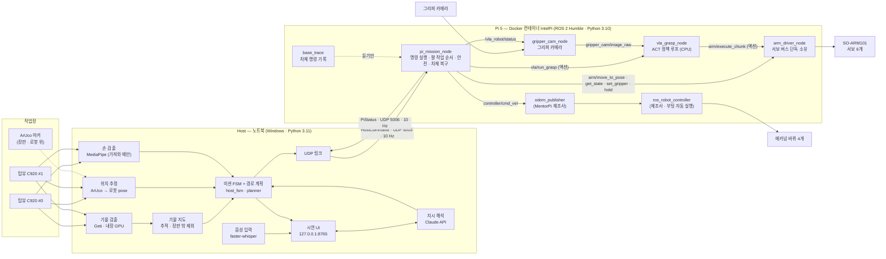

# 시스템 구성

> 기준: `vla_robot/` 코드 (2026-10-13 실기 확인본). 인터페이스 세부는 [interfaces.md](interfaces.md), 폴더·모듈은 [modules.md](modules.md).

장판 위 기물을 **탑뷰 카메라 2대**로 찾고, **메카넘 차체**로 다가가 **SO-ARM101 팔 + VLA 정책(ACT)** 으로 집어
바구니에 넣거나("모두 정리해줘") 사람 손에 건넵니다("룩 가져와").

## 1. 역할 분담

| | 맡는 것 | 맡지 않는 것 |
|---|---|---|
| **Host** (노트북) | **공간 전부** — 로봇 위치(ArUco), 기물 지도(검출), 손, 경로, 속도 결정, 미션 순서, 지시 해석, 화면 | 모터·서보를 직접 다루지 않는다 |
| **Pi** (로봇 위 Raspberry Pi 5) | 받은 **속도 실행**, **팔 작업**(파지 · 내려놓기 · 건네기) 실행과 결과 보고, 안전(명령 끊김 정지 · ESTOP) | 좌표를 모른다 — 명령에 좌표가 없다 |

Host 가 보내는 명령은 "지금 상태 + 속도(또는 정지) + 대상 라벨" 뿐입니다. 라벨은 정책 지시문("pick up the queen")에만 쓰입니다.

## 2. 구성도

## 3. 어디서 무엇이 도나

| 위치 | 실행 | 하드웨어 · 환경 |
|---|---|---|
| 노트북 | `vla_robot/host/run_host.py` 한 프로세스 (+ 검출·지시·음성 백그라운드 스레드) | Windows, Python 3.11 venv · 탑뷰 C920 ×2(USB) · 검출은 OpenVINO `GPU.0`(내장 그래픽), 안 되면 CPU |
| Pi 5 | Docker 컨테이너 `IntelPi` 안 `robot.launch.py` — 노드 5개 + 기록기 | ROS 2 Humble, Python 3.10 · 팔 서보 버스(USB 시리얼) · 그리퍼 카메라(USB) · 차체 보드(MentorPi) |
| Pi 5 (부팅 자동) | `ros_robot_controller` — 제조사 차체 보드 드라이버 | 런치에서 다시 띄우지 않는다(둘이 되면 바퀴가 안 돈다) |
| (보류) 노트북 GPU | `vla_robot/policy_server/` — Diffusion Policy 원격 추론 | `robot_dp.yaml` 을 쓸 때만. 기본(ACT)은 Pi CPU 에서 직접 추론 |

## 4. 한 사이클 (Host 10 Hz)

1. 탑뷰 2대에서 프레임을 읽는다. 지시 대기 중에는 처리 간격을 늘려 CPU 를 아낀다.
2. ArUco 로 각 카메라 위치를 맞추고 로봇 pose(x, y, yaw)를 구한다 — 두 카메라 결과를 합친다.
3. 검출 결과(카메라별 bbox)를 장판 좌표로 바꿔 기물 지도를 갱신한다. 장판 밖 검출과 방금 사람에게 건넨 기물은 뺀다.
4. "가져와" 중이면 손을 찾는다(두 카메라가 같은 손을 보면 광선 교차로 높이까지).
5. 미션 FSM 이 다음 행동을 정한다 — 대상 선택 → 경로 → "회전 / 직진 / 정지" 시퀀스 → 속도. 팔 작업이 필요하면 상태를 GRASP · PLACE 로 바꿔 보낸다.
6. `HostCommand` 하나를 UDP 로 보내고, 최신 `PiStatus` 로 팔 작업 결과 · 차체 상태 · 전압을 받는다.
7. 시연 UI · 궤적 기록(`host/logs/traj_*.csv`)을 갱신한다.

Pi 는 명령이 0.5 s 끊기면 스스로 정지합니다(watchdog). 팔 작업은 Pi 안에서 끝까지 진행하고 결과만 보고합니다.

## 5. 설계 원칙

- **공간은 Host 하나가 소유한다.** Pi 는 좌표를 모르고 속도와 팔 작업만 실행한다 — 위치 오차의 원인이 한 곳에만 있다.
- **사건을 잃지 않는다.** UDP 라 패킷이 빠질 수 있으므로, Pi 는 마지막 작업 결과를 매 상태 패킷에 반복해 싣는다. Host 는 `job_id` 가 바뀐 것을 보고 완료를 안다(`boot_id` 로 Pi 재시작도 구분). → [interfaces.md](interfaces.md)
- **장치는 한 노드만 만진다.** 팔 서보 버스는 `arm_driver_node`, 그리퍼 카메라는 `gripper_cam_node` 가 단독 소유한다.
- **규격은 한 파일.** Host 와 Pi 가 같은 `vla_common/protocol.py` 를 import 한다 — 양쪽 규격이 갈라질 수 없다.
- **설정은 엄격하게.** 모르는 설정 키가 있으면 기동을 거부한다(`host.yaml` · `robot.yaml`). 값마다 근거(날짜 · 실측)를 주석으로 남긴다.
- **판단 로직은 ROS 밖에.** 미션 코어 · 차체 복구 · 파지 사이클 판정 · 속도 제한은 ROS 없는 순수 모듈로 떼어 시험한다(Host 241 · Pi 쪽 87, CI 가 매번 실행).
- **실기 전에 시뮬.** `host/sim/` 이 카메라·차량 없이 Host 전체 흐름을 돌린다(`host/tools/sim_regress.py` 로 교육장 배치 회귀).

## 6. 설정 파일

| 파일 | 위치 | 내용 |
|---|---|---|
| `host.yaml` | `vla_robot/host/config/` | ArUco · 장판 · 카메라 · 검출 · 손 · 추적 · 경로 · 주행 · 미션 · 링크 · 건네기 · 음성 · 지시 · 화면 |
| `robot.yaml` | `vla_robot/ros2_ws/src/vla_robot_bringup/config/` | 팔 · 차체 · 링크 · 그리퍼 카메라 · 정책(ACT) · 파지 확인 · 내려놓기 · 미션 — **기본** |
| `robot_dp.yaml` | 위와 같은 곳 | Diffusion Policy(원격 추론) 판 — 보류 |
| `arm_calibration.json` · `arm_poses.yaml` | 위와 같은 곳 | 팔 캘리브레이션 · 이름 자세(실측) |
| `calib/cam0.npz` · `cam1.npz` | `vla_robot/host/calib/` | 탑뷰 카메라 내부 파라미터 |

모델 파일(ACT 체크포인트 · Geti 검출 · 손 · 음성)은 저장소에 넣지 않습니다 — 위치는 [handover.md](handover.md).
