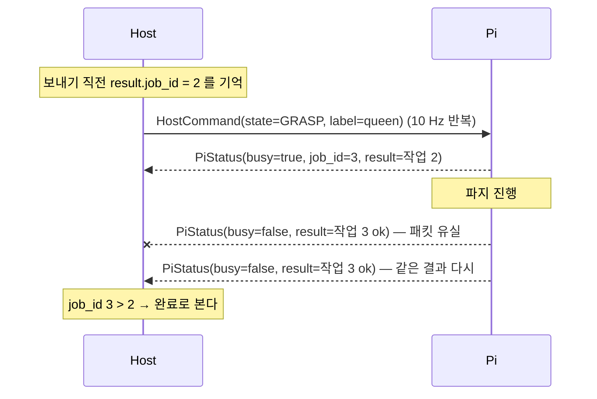

# 인터페이스

> 기준: `vla_robot/` 코드 (2026-10-13). 원본은 코드입니다 — UDP 는 `ros2_ws/src/vla_common/vla_common/protocol.py`,
> ROS 메시지는 `ros2_ws/src/vla_robot_interfaces/`. 구성은 [architecture.md](architecture.md).

## 1. Host ↔ Pi (UDP · JSON)

| 방향 | 포트 | 주기 | 내용 |
|---|---|---|---|
| Host → Pi | **5005** | Host 사이클(10 Hz) | `HostCommand` |
| Pi → Host | **5006** | 10 Hz (`link.status_hz`) | `PiStatus` |

Host 와 Pi 가 `vla_common.protocol` 모듈을 **같이 import** 합니다. 패킷에는 버전 `"v": 1` 이 붙고, 모르는 버전은 거부합니다.
새로 더한 키는 기본값이 있어 옛 상대가 모르는 키를 무시해도 동작합니다.

### 1-1. 로봇 상태 (`State`)

| 값 | 뜻 | 차체 | 팔 |
|---|---|---|---|
| `IDLE` | 할 일 없음 | 속도 명령을 따른다(보통 정지) | — |
| `APPROACH` | 기물로 주행 | 이동 | — |
| `GRASP` | 정지 + 파지 작업 | 정지 | VLA 파지 |
| `CARRY` | 기물을 든 채 주행 | 이동 | 쥔 채 유지 |
| `APPROACH_BOX` | 바구니(또는 손) 앞 미세 주행 | 이동 | 쥔 채 유지 |
| `PLACE` | 정지 + 내려놓기 · 건네기 작업 | 정지 | 투입 또는 건네기 |
| `ESTOP` | 즉시 정지, 진행 중인 팔 작업 취소 | 정지 | 취소 |

Host 미션의 세부 단계(대상 찾기 · 재시도 · 복구 등)는 Host 안에만 있고, Pi 에는 위 7개만 보입니다.

### 1-2. `HostCommand` (Host → Pi)

| 키 | 형 | 단위 · 뜻 |
|---|---|---|
| `state` | 문자열 | 위 `State` |
| `linear_x` | 실수 | m/s, + 앞 |
| `linear_y` | 실수 | m/s, + 왼쪽(메카넘 옆 이동) |
| `angular_z` | 실수 | rad/s, + 반시계 |
| `stop` | 참/거짓 | 참이면 속도 필드를 무시하고 정지 |
| `label` | 문자열 | 정책 지시문용 기물 라벨(예: `queen`). **좌표가 아니다** |
| `seq` | 정수 | 명령 번호 — Pi 가 `ack_seq` 로 돌려준다 |
| `arm_yaw_deg` | 실수 | PLACE 에서만. 차를 상자 정면에 세운 뒤 남는 좌우 각도를 팔 base 회전으로 메운다(Pi 가 상한으로 자름) |
| `recover_base` | 참/거짓 | Host 가 "움직이라 했는데 탑뷰상 안 움직인다"를 봤을 때만 참 → Pi 가 차체 컨트롤러를 다시 띄운다 |
| `place_pose` | 문자열 | PLACE 에서만. `"handover"` = 사람 손에 건네기, `""` 또는 `"drop"` = 바구니 투입 |

Pi 는 받은 속도를 `robot.yaml` 의 한계(직진 0.15 m/s · 회전 0.5 rad/s)로 자르고 20 Hz 로 차체에 냅니다.
명령이 **0.5 s** 끊기면(`base.watchdog_s`) 정지하고 `watchdog` 을 참으로 보고합니다.

### 1-3. `PiStatus` (Pi → Host)

| 키 | 뜻 |
|---|---|
| `boot_id` | Pi 미션 노드가 뜰 때마다 바뀌는 값 — 재시작 구분 |
| `state` · `busy` | Pi 가 실행 중인 상태 · 팔 작업 진행 중 여부 |
| `job_id` | 진행 중(또는 마지막) 팔 작업 번호. 0 = 없음 |
| `result` | **마지막으로 끝난** 작업의 `JobResult` — 다음 작업이 끝날 때까지 매 패킷 반복 |
| `job_stage` | 작업 안 단계(화면용). PLACE: `move` → `release` → `return` |
| `base_ok` · `watchdog` | 구동계가 명령을 받아 가는가 · 명령이 끊겨 정지 중인가 |
| `base_recovering` · `base_recoveries` | 차체 컨트롤러 복구 중인가 · 부팅 후 끝낸 복구 횟수 |
| `battery_v` · `arm_v` | 차체 · 팔 전압(V). 0 = 모름 |
| `ack_seq` · `detail` | 마지막으로 받은 명령 번호 · 참고 문구 |

`JobResult` = `job_id`, `action`(`GRASP`/`PLACE`), `ok`, `detail`(예: `파지 5청크 — 근접 변화 44.5% · 그리퍼 9.2% · 부하 0.14 (17.8s)`).

### 1-4. 팔 작업 완료를 놓치지 않는 법

- 완료 보고를 한 번만 보내지 않고 **마지막 결과를 계속 싣습니다** — 패킷이 몇 개 빠져도 다음 패킷이 같은 결과를 가져옵니다.
- Pi 가 재시작하면 `job_id` 가 0 부터 다시 셉니다. Host 는 `boot_id` 가 바뀌면 기준을 0 으로 되돌립니다.
- 차체 복구도 같은 방식: 참/거짓 대신 **횟수**(`base_recoveries`)가 늘어난 것으로 끝을 압니다.

## 2. Pi 안 (ROS 2)

### 2-1. 노드

| 노드 | 패키지 | 하는 일 |
|---|---|---|
| `pi_mission_node` | `vla_robot_mission` | UDP 명령 → 차체 속도 · 팔 작업 순서 · ESTOP · 차체 컨트롤러 복구 · 상태 보고 |
| `vla_grasp_node` | `vla_robot_policy` | 파지 한 번 = ACT 정책 루프(그리퍼 영상 + 관절 → 관절 청크) |
| `gripper_cam_node` | `vla_robot_vision` | 그리퍼 카메라 단독 소유 · 영상 발행. 팔 작업이 없으면 0.5 s 마다 한 장만 풀어 CPU 를 아낀다 |
| `arm_driver_node` | `vla_robot_arm` | 팔 서보 버스(Feetech STS3215 ×6) 단독 소유 · 자세 이동 · 청크 실행 · 상태 읽기 |
| `odom_publisher` | `controller`(MentorPi 제조사) | `controller/cmd_vel` → 차체 보드 |
| `base_trace` | `vla_robot/tools/ops/base_trace.py` | 차체 명령 → 모터 명령 → IMU 를 듣기만 해서 `/tmp/base_trace.csv` 로 기록(무응답 추적) |

### 2-2. 토픽

| 토픽 | 형 | 내는 쪽 → 받는 쪽 |
|---|---|---|
| `controller/cmd_vel` | `geometry_msgs/Twist` | pi_mission_node → odom_publisher (정지도 계속 낸다) |
| `odom_raw` | `nav_msgs/Odometry` | 제조사 → pi_mission_node (도착 시각만 봄 — 구동계 생존 확인) |
| `/ros_robot_controller/battery` | `std_msgs/UInt16` (mV) | 제조사 → pi_mission_node |
| `gripper_cam/image_raw` | `sensor_msgs/Image` | gripper_cam_node → vla_grasp_node |
| `/vla_robot/status` | `vla_robot_interfaces/RobotStatus` | pi_mission_node → gripper_cam_node · base_trace |
| `/vla_robot/estop` · `/vla_robot/estop_reset` | `std_msgs/Empty` | (조작자) → pi_mission_node — ESTOP 래치 · 해제 |

### 2-3. 서비스 (`arm_driver_node` 제공)

| 이름 | 형 | 쓰임 |
|---|---|---|
| `arm/get_state` | `GetArmState` | 관절 6개 raw · 정책 단위 값 · 부하 · 온도 · 전압 · 토크 |
| `arm/set_gripper` | `SetGripper` | 그리퍼 개도(%) → 최종 개도 · 부하 |
| `arm/hold` | `std_srvs/Trigger` | 지금 자세 유지 |
| `arm/set_torque` | `std_srvs/SetBool` | 토크 켜기/끄기 |

### 2-4. 액션

| 이름 | 형 | 서버 → 클라이언트 | 목표 → 결과 |
|---|---|---|---|
| `vla/run_grasp` | `RunVlaGrasp` | vla_grasp_node ← pi_mission_node | `label`, `timeout_s` → `ok`, 청크 수, 시간, 그리퍼 개도 · 부하 (피드백: 청크 번호 · 추론 ms) |
| `arm/execute_chunk` | `ExecuteJointChunk` | arm_driver_node ← vla_grasp_node | 관절 값 묶음(6의 배수) · fps → 실행 스텝 수 · 잘린 스텝 수 |
| `arm/move_to_pose` | `MoveToPose` | arm_driver_node ← pi_mission_node | 이름 자세 또는 관절 6개 · 그리퍼 모드 · 시간 → 최종 자세 |

## 3. Host 내부 (참고)

| 경계 | 형태 |
|---|---|
| 시연 UI ↔ run_host | `http://127.0.0.1:8765` — `ui/grippers-ui.html` 이 상태를 받아 그리고, 입력창 · 마이크 · 실행 · ESTOP · 바구니 선택 같은 조작을 돌려준다 |
| 지시 해석 | Claude API(`ANTHROPIC_API_KEY` 환경변수) — 보이는 기물 라벨 안에서만 고른다 |
| 정책 원격 추론(보류) | `policy_server` HTTP — 규격은 `vla_common/policy_wire.py` |
