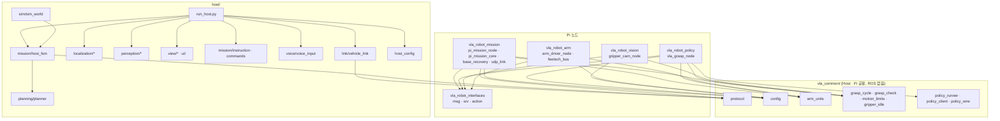

# 폴더 · 모듈 구성

> 기준: `vla_robot/` 코드 (2026-10-13). 무엇이 어디서 도는지는 [architecture.md](architecture.md), 주고받는 값은 [interfaces.md](interfaces.md).

## 1. 저장소

```
grippers/
├── vla_robot/            최종 시스템 — 아래 2절
├── docs/                 현재 시스템 문서 (이 문서)
├── legacy/               2026년 8월 초기 설계의 코드와 문서 (기록용, 실행하지 않음)
├── ros2_ws/src/          MentorPi 제조사 ROS 2 패키지 (원본 참고 — Pi 컨테이너에는 같은 것이 설치돼 있다)
├── docker/               Pi 컨테이너(IntelPi) 정의
├── third_party/          SO-ARM 제공 자료 (서브모듈)
└── .github/workflows/    CI — 린트 · legacy 시험 · vla_robot Host 시험 · Pi 쪽 시험
```

## 2. `vla_robot/`

```
vla_robot/
├── host/                 노트북(Host) — run_host.py 하나로 뜬다
│   ├── run_host.py       메인 루프
│   ├── host_config.py    host.yaml 로더(모르는 키 거부)
│   ├── config/ calib/    설정 · 탑뷰 카메라 내부 파라미터
│   ├── localization/     카메라 · ArUco → 로봇 pose
│   ├── perception/       기물 검출 · 기물 지도 · 손
│   ├── mission/          미션 FSM · 지시 해석 · 바구니 목표 · 차체 감시 · 궤적 기록
│   ├── planning/         경로 계획 · 회전/직진/정지 시퀀서
│   ├── link/             Pi 와 UDP
│   ├── view/ ui/         시연 UI(웹) · OpenCV 지도
│   ├── voice/            음성 입력
│   ├── sim/              카메라·차량 없는 시뮬레이터
│   ├── tools/            캘리브레이션 · 배치 · 점검 · 회귀 도구
│   └── tests/            Host 시험(241)
├── ros2_ws/src/          Pi(ROS 2 Humble) 패키지 — 아래 4절
├── policy_server/        (보류) 노트북 GPU 정책 추론 서버 — Diffusion Policy 판
├── tools/                팔 도구(캘리브레이션 쓰기 · 자세 실측 · 점검) · tools/ops(Pi 점검 · 전력 · 차체 복구 · 기록)
└── udev/                 Pi 장치 이름 고정 규칙
```

## 3. 의존 관계



- `vla_common` 은 **ROS 를 import 하지 않습니다** — Host(Windows)와 Pi 가 같이 쓰고, CI 에서 ROS 없이 시험합니다.
- Host 는 `vla_common` 을 `pip install -e ../ros2_ws/src/vla_common` 으로 씁니다(`host/requirements.txt`).
- Pi 노드끼리는 import 하지 않고 토픽 · 서비스 · 액션으로만 대화합니다.

## 4. 모듈

### Host (`vla_robot/host/`)

| 모듈 | 줄 | 하는 일 |
|---|---:|---|
| `run_host.py` | 322 | 메인 루프 — 탑뷰 + ArUco + 검출 → FSM → Pi(UDP) · 화면 · 기록 |
| `host_config.py` | 541 | `host.yaml` 을 엄격하게 읽는다 |
| `localization/aruco_localizer.py` | 294 | ArUco → 카메라 외부 파라미터 → 높이 고정 로봇 pose, 두 카메라 합치기 |
| `localization/cameras.py` · `pose.py` | 113 · 27 | 탑뷰 카메라 열기/읽기 · pose 값 객체 |
| `perception/detector.py` | 191 | 기물 검출(Geti, OpenVINO 내장 GPU → 안 되면 CPU), 백그라운드 |
| `perception/piece_tracker.py` | 144 | 검출 → 장판 좌표 기물, 프레임 간 추적 · 장판 밖 제외 |
| `perception/hands.py` | 288 | 손 검출(MediaPipe) · 두 카메라 광선 교차 |
| `mission/host_fsm.py` | 2017 | **미션 상태머신** — 대상 선택 · 접근 · 파지 · 운반 · 투입/건네기 · 재시도 · 회피 · 복구 |
| `mission/basket_target.py` | 97 | 바구니 투입 목표 · 접근 판정(순수 계산) |
| `mission/base_monitor.py` | 185 | 차체가 명령을 따르는지 탑뷰로 감시 → 무응답 · 폭주 판정 |
| `mission/instruction.py` · `commands.py` | 197 · 154 | 자연어 지시 → (기물 · 개수 · 정리/가져와), Claude API |
| `mission/trajectory_log.py` | 100 | 사이클마다 한 줄 CSV(`host/logs/traj_*.csv`) |
| `planning/planner.py` | 581 | 격자 경로 탐색 + 직선화, 회전/직진/정지 시퀀서 |
| `link/vehicle_link.py` | 145 | UDP 링크(+ 콘솔 링크: 시뮬용) |
| `view/web_view.py` · `ui_state.py` · `map_view.py` | 274 · 395 · 153 | 시연 UI 서버 · UI 상태 · OpenCV 지도 |
| `voice/voice_input.py` | 226 | 내장 마이크 → 한국어 문장(faster-whisper, 오프라인) |
| `sim/sim_world.py` | 309 | 카메라·차량 없이 Host 전체 흐름 시뮬 |

### Pi (`vla_robot/ros2_ws/src/`)

| 패키지 · 모듈 | 줄 | 하는 일 |
|---|---:|---|
| `vla_robot_mission/pi_mission_node.py` | 604 | ROS 배선 · 팔 작업 순서(GRASP: 시작 자세 → 파지 → 확인 → 운반 자세 / PLACE: 운반 → 투입·건네기 자세 → 열기 → 복귀) |
| `vla_robot_mission/pi_mission_core.py` | 163 | 명령 · 작업 · ESTOP · watchdog 판단(순수 로직) |
| `vla_robot_mission/base_recovery.py` | 159 | 차체 컨트롤러 재기동 · 미리 재기동 정책(순수 로직) |
| `vla_robot_mission/udp_link.py` | 99 | Pi 쪽 UDP 송수신 |
| `vla_robot_policy/vla_grasp_node.py` | 328 | `vla/run_grasp` 액션 — 정책 루프 · 사이클 끝 판정 |
| `vla_robot_vision/gripper_cam_node.py` | 195 | 그리퍼 카메라 단독 소유 · 대기 중 절전 |
| `vla_robot_arm/arm_driver_node.py` | 532 | 팔 버스 단독 소유 · 자세 이동 · 청크 실행 · 상태 · 전압 · 온도 확인 |
| `vla_robot_arm/feetech_bus.py` | 335 | Feetech STS3215 시리얼 프로토콜 |
| `vla_robot_bringup/` | — | `robot.launch.py` · `robot.yaml` · `robot_dp.yaml` · 캘리브레이션 · 자세 |
| `vla_robot_interfaces/` | — | `RobotStatus` · `GetArmState` · `SetGripper` · `RunVlaGrasp` · `ExecuteJointChunk` · `MoveToPose` |
| `vla_common/protocol.py` | 331 | Host ↔ Pi UDP 규격(단일 원본) |
| `vla_common/config.py` | 413 | `robot.yaml` 로더(모르는 키 거부) |
| `vla_common/arm_units.py` | 228 | 서보 raw ↔ 정책 단위(LeRobot 정규화) |
| `vla_common/policy_runner.py` | 198 | 로컬 정책 추론(ACT · DP 공용, ROS 없음) |
| `vla_common/grasp_cycle.py` · `grasp_check.py` | 126 · 32 | 파지 사이클 끝 판정 · 그리퍼 영상으로 쥐었는지 확인 |
| `vla_common/motion_limits.py` · `gripper_idle.py` | 86 · 20 | 속도 제한 · 카메라 절전 판단 |

## 5. 시험

| 위치 | 수 | 무엇을 | CI 작업 |
|---|---:|---|---|
| `vla_robot/host/tests/` | 241 | FSM · 경로 · 위치 추정 · 검출 후처리 · UI 상태 · 지시 · 음성 · 시뮬 전 과정 | vla_robot Host tests (Python 3.11) |
| `vla_robot/ros2_ws/src/vla_common/test/` + `vla_robot_mission/test/test_base_recovery.py` | 87 | 규격 · 설정 · 단위 변환 · 파지 판정 · 차체 복구 | vla_robot Pi-side tests (Python 3.10) |
| `legacy/tests/` | 145 | 초기 설계 코드 | Legacy unit tests |

로컬: `vla_robot/host` 에서 `pytest` · 저장소 루트에서 `ruff check .`.
