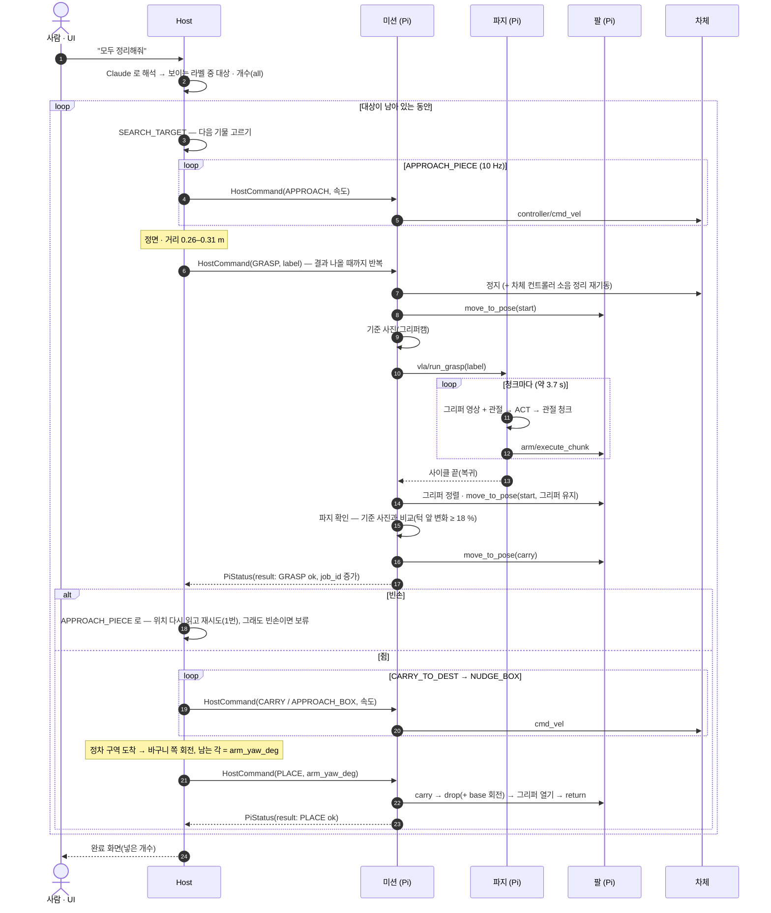
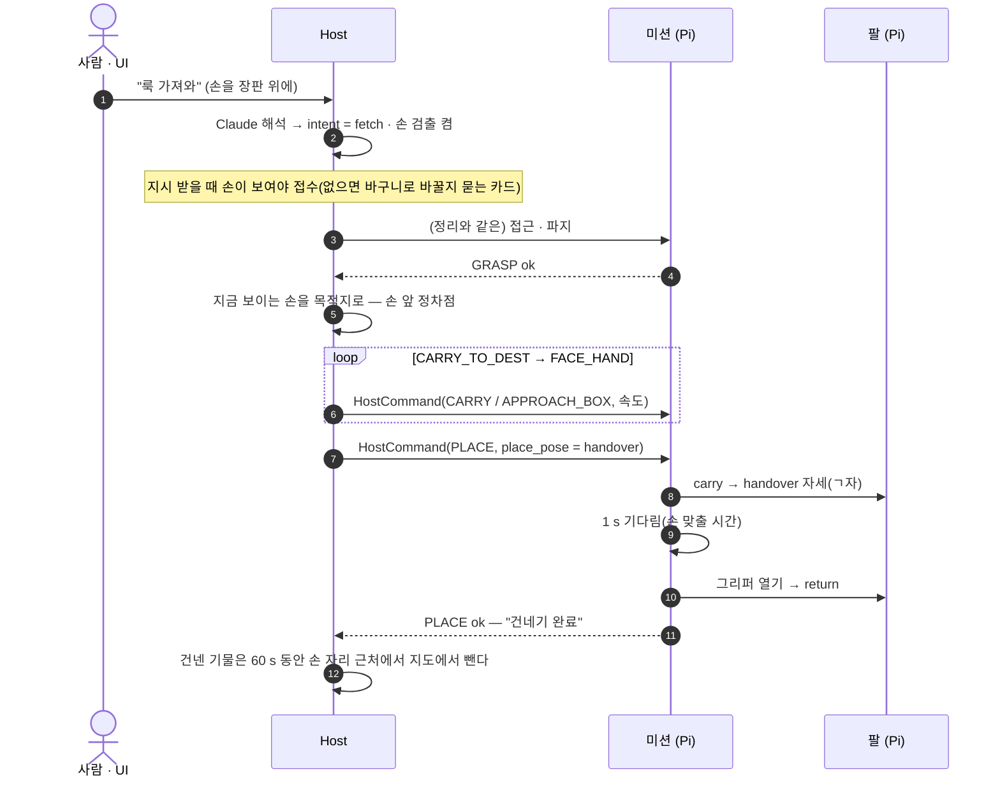
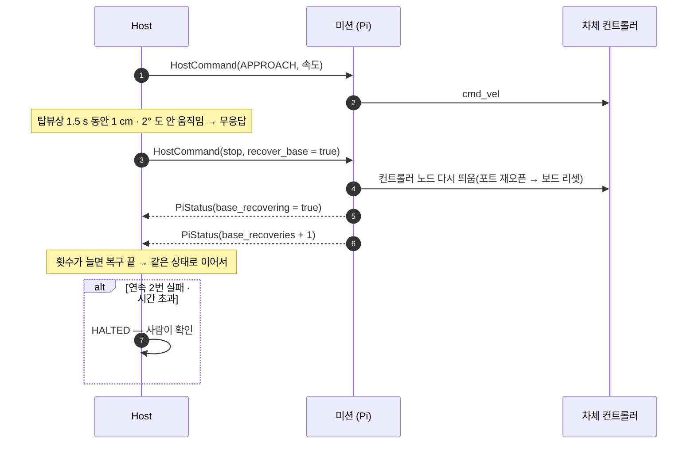

# 시퀀스

> 기준: `vla_robot/` 코드 (2026-10-13). 상태 이름은 [state_machine.md](state_machine.md), 메시지 필드는 [interfaces.md](interfaces.md).

등장하는 쪽:

| 이름 | 실체 |
|---|---|
| 사람 · UI | 시연 UI(입력창 · 마이크) |
| Host | `run_host.py` — 위치 추정 · 검출 · 미션 FSM (노트북) |
| 미션 | `pi_mission_node` (Pi) |
| 파지 | `vla_grasp_node` — ACT 정책 루프 (Pi) |
| 팔 | `arm_driver_node` — 서보 버스 (Pi) |
| 차체 | `odom_publisher` → 제조사 컨트롤러 → 바퀴 (Pi) |

## 1. 정리 — 기물 하나

- 한 기물 파지는 실기에서 15~21 s(4~5 청크), 투입은 약 9 s 입니다.
- 바구니로 가는 움직임은 기물 · 자리와 관계없이 **회전 → 직진 → 회전 → 투입** 한 모양을 씁니다([decisions.md](decisions.md)).

## 2. 가져와 — 사람 손에 건네기

- 손은 MediaPipe 로 찾고, 두 카메라가 같은 손을 보면 광선 교차로 높이까지 풉니다. 손이 옮겨 가면 파지 뒤 **보이는 손**으로 갑니다.
- 손 검출은 CPU 를 아끼려고 "가져와" 해석 · 대기 · 건네기 때만 켭니다.

## 3. 차체 무응답 복구

차체 보드가 쓰기를 오류 없이 무시하는 고장(2026-09-23 · 09-30)에 대한 대응입니다.

미리 막는 재기동도 있습니다 — 스택 기동 직후, 팔 작업 시작 때(바퀴 울음 정리), **60 s 넘게 서 있다 첫 출발 전**(약 6 s).
그래도 드물게(재기동 5 s 뒤 27번 중 1번) 무응답이 남아 위 복구가 처리합니다.
