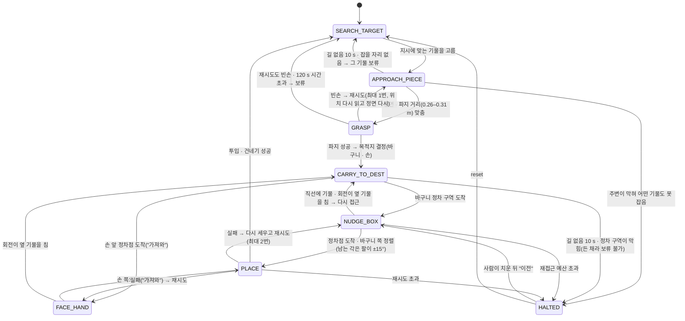
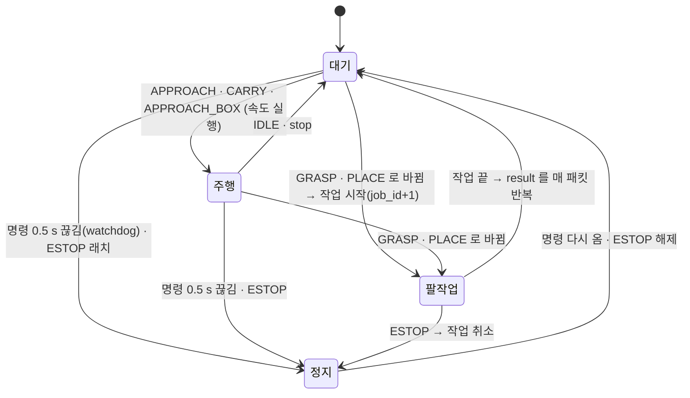

# 상태도

> 기준: `vla_robot/host/mission/host_fsm.py` · `vla_common/protocol.py` (2026-10-13). 값은 `host/config/host.yaml`.
> 동작 · 설정 키의 자세한 설명은 [behavior.md](behavior.md), 흐름 예시는 [sequences.md](sequences.md).

상태는 두 층입니다.

- **Host 미션 상태**(`HostState`, 8개) — 미션의 실제 단계. Host 안에만 있다.
- **로봇 상태**(`State`, 7개) — Host 가 매 사이클 Pi 에 보내는 값. Pi 는 이것만 본다.

## 1. Host 미션 상태

| 상태 | 하는 일 | Pi 에 보내는 로봇 상태 |
|---|---|---|
| `SEARCH_TARGET` | 지시(라벨 · 개수)에 맞는 다음 기물 고르기. 바구니 앞을 막는 기물 먼저, 거리가 비슷하면 정차 구역 가까운 기물 먼저 | `IDLE`(정지) |
| `APPROACH_PIECE` | 기물 앞까지 경로 계획 + 회전/직진/정지 시퀀스, 정면 · 거리 맞추기 | `APPROACH` |
| `GRASP` | Pi 가 파지하는 동안 정지해 기다림 — 결과는 `job_id` 로 판정 | `GRASP` |
| `CARRY_TO_DEST` | 든 채 바구니 정차 구역(또는 손 앞 정차점)까지 | `CARRY` |
| `NUDGE_BOX` | 정차점에 붙기 · 바구니 쪽 회전 · 남는 각도 계산(`arm_yaw_deg`) | `APPROACH_BOX` |
| `FACE_HAND` | 손 앞 정차점에서 손 쪽 보기 | `APPROACH_BOX` |
| `PLACE` | Pi 가 넣거나(`drop`) 건네는(`handover`) 동안 기다림 | `PLACE` |
| `HALTED` | 기물을 든 채 갈 곳이 없음 — **사람이 개입** | `IDLE`(정지 · 든 채 유지) |

- **보류(skip)**: 못 잡은 기물은 잠시 목록에서 빼고 다음 기물로 간다. 든 채인 단계(운반 · 투입)는 보류할 수 없어 `HALTED` 로 간다.
- **지시 단위**: `quantity = one` 이면 하나 옮기고 지시 끝, `all` 이면 보이는 대상이 없을 때까지 `SEARCH_TARGET` 으로 돈다.
- **단계 모드**: `run_host.py --step`(또는 화면에서 MANUAL 로 전환)이면 파지 · 투입 같은 단계 끝마다 "다음" 을 눌러야 넘어간다(기본은 자동).

## 2. 상태와 겹쳐 도는 감시

상태를 바꾸지 않고 **그 사이클 명령만 덮어쓰는** 것들입니다.

| 감시 | 언제 | 하는 일 |
|---|---|---|
| **ESTOP** | 시연 UI · 키 | 래치 — 모든 명령이 정지. `reset` 으로만 풀린다(실수로 재개되지 않게) |
| **무응답(stall)** | 주행 단계에서 움직이라 했는데 1.5 s 동안 1 cm · 2° 도 안 움직임 | `recover_base` 로 차체 컨트롤러 재기동 요청 → 끝나면 이어서. 연속 2번 실패하면 `HALTED` |
| **폭주(runaway · spin)** | 정지인데 0.5 s 에 5 cm 넘게 움직이거나 돈다 | 보드 리셋 요청(ESTOP 중에도) |
| **pose 잃음** | 탑뷰가 로봇 마커를 못 봄 | 주행 상태면 정지 명령(상태 이름은 유지), GRASP · PLACE 는 그대로(팔이 마커를 가리는 것은 정상) |

Host 는 pose 를 잃어도 **매 사이클 명령 하나는 반드시 보냅니다** — 안 보내면 Pi watchdog 이 세우지만 화면엔 원인이 안 보였습니다(2026-09-05).

## 3. Pi 쪽

Pi 미션 노드는 받은 로봇 상태를 그대로 실행합니다. `GRASP` · `PLACE` 로 **바뀌는 순간** 팔 작업을 하나 시작하고 끝까지 진행합니다.

- 팔 작업 중에는 차체를 세웁니다. 작업 시작 때와 오래(60 s 넘게) 서 있다 첫 출발 전에는 차체 컨트롤러를 미리 재기동합니다(바퀴 울음 정리 · 첫 명령 무응답 방지, 약 6 s).
- 작업 순서(파지 · 투입 · 건네기)는 [sequences.md](sequences.md).
